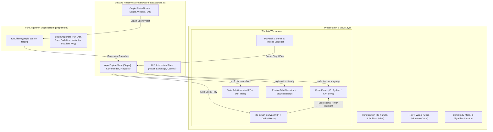

# DIJKSTRA LAB 🌐

> A premium, fully animated, interactive 3D visualizer that teaches Dijkstra's shortest path algorithm with multi-language code synchronization, step-by-step state introspection, and real-time graph editing.

---

## 🌟 Key Features

- **Cinematic 3D WebGL Canvas**: Powered by `@react-three/fiber`, `@react-three/drei`, and postprocessing bloom. Features glowing nodes, directional edge arrows, billboard weight badges, relaxation photon pulses, expanding ripple rings, and an infinite coordinate starfield.
- **Pure Algorithm Execution Engine**: Dijkstra is modeled as a pure generator (`src/algo/dijkstra.ts`) producing an immutable snapshot stream of steps (`init`, `pop`, `visit`, `relax-check`, `relax-update`, `skip`, `done`, `path`). Scrubbing and time-traveling backward/forward are $O(1)$ operations with zero recalculation latency.
- **Tri-Language Synchronized Code Panel**:
  - Live implementations in **JavaScript (ES6)**, **Python (heapq)**, and **C++ (STL priority_queue)**.
  - Active line highlight glides smoothly between lines using Framer Motion's shared `layoutId="code-highlight-bar"`.
  - **Bidirectional Hover Introspection**:
    - Hovering any code line reveals its semantic explanation, live variable values at the current step ($u, v, w, \text{newDist}$), and highlights candidate elements in 3D space. Includes a **"Run to Here"** button to fast-forward playback directly to that line.
    - Hovering any 3D node or edge highlights the corresponding algorithm code lines.
  - **Live Variables Watch Strip**: Displays live mutation pulses for active variables ($u, v, w, \text{newDist}$).
- **Interactive State & Explain Tabs**:
  - **Min-Priority Queue**: Animated chip stack that reorders with Framer Motion layout springs and pops extracted nodes.
  - **Distance & Predecessor Table**: Live tabular grid showing vertex costs, predecessor links, and status (`unvisited`, `frontier`, `settled`, `path`).
  - **Step Narration**: Live plain-English explanation of each algorithmic decision with Beginner vs Detailed mathematical rigor toggle, plus optional Web Speech audio narration.
- **Full Interactive Graph Editor**:
  - Drag nodes freely in 3D/2D space.
  - Double-click empty space to create nodes.
  - Shift-drag between nodes to create edges with promptable weights.
  - Click any edge weight badge to edit its weight in real time.
  - Right-click any node or edge to delete it.
  - Preset switcher: **Classic Textbook**, **Diamond**, **City Grid**, and **Random Graph Generator** (customizable node count & density).
  - Negative weight guardrail: friendly alert explaining the greedy invariant violation.
- **Playback Bar & Ergonomics**:
  - Play, Pause, Step Forward, Step Backward, Reset, Jump to Result.
  - Milestone scrubber with node-settled indicators.
  - Speed toggle ($0.5\times, 1\times, 2\times, 4\times$) and "Auto-play on change".
  - Global keyboard shortcuts: `Space` (Play/Pause), `ArrowLeft`/`ArrowRight` (Step Back/Forward), `R` (Reset).
- **Comprehensive Educational Content**:
  - Hero with floating 3D graph and mouse parallax.
  - 5-step "How It Works" guide with micro-animation visualizers.
  - Complexity matrix comparing Array $O(V^2)$ vs Binary Heap $O((V+E)\log V)$ vs Fibonacci Heap $O(E + V\log V)$.
  - Algorithmic shootout: Dijkstra vs BFS vs Bellman-Ford vs A* vs Floyd-Warshall.
  - Real-world applications (GPS, OSPF internet routing, flight booking, social graphs).

---

## 🏛️ System Architecture



---

## 🚀 Running the Project

### Prerequisites
- Node.js (v18+)
- npm or pnpm

### Setup & Launch
```bash
# Clone or navigate to the repository
cd dijkstra-lab

# Install dependencies
npm install

# Start development server
npm run dev
# -> Opens on http://127.0.0.1:5173

# Run unit tests
npm test # or: npx vitest run

# Production build
npm run build
```

---

## 🛠️ Adding a New Language Tab or Algorithm

### 1. Adding a New Language Tab (e.g., Java or Rust)
1. Open `src/algo/types.ts` and add the language key to `SupportedLanguage`:
   ```typescript
   export type SupportedLanguage = 'javascript' | 'python' | 'cpp' | 'java';
   ```
2. Open `src/algo/codeSnippets.ts`:
   - Add the code line definitions under `CODE_SNIPPETS.java`:
   ```typescript
   java: {
     title: 'Java (PriorityQueue)',
     lines: [
       { lineNumber: 1, code: 'public static Map<Node, Integer> dijkstra(...) {' },
       ...
     ]
   }
   ```
3. Open `src/algo/dijkstra.ts`:
   - Update each step snapshot's `codeLine` mapping to specify the corresponding Java line number:
   ```typescript
   codeLine: { javascript: 5, python: 5, cpp: 6, java: 4 }
   ```
4. In `src/components/code/CodePanel.tsx`, add `'java'` to the language switch tab list.

### 2. Adding a New Algorithm (e.g., A* or Bellman-Ford)
1. Create a pure step generator in `src/algo/<algo_name>.ts` that receives `GraphData` and returns an array of `DijkstraStep` objects matching the standard snapshot contract.
2. Add an algorithm selector in `src/store/useLabStore.ts` to swap between step generator functions.
3. The entire 3D canvas, state tab, code panel, and playback scrubber will automatically bind to the new algorithm's snapshots without modifying the visual components!

---

## 📄 License
MIT License. Created with precision for computer science pedagogy and interactive learning.
